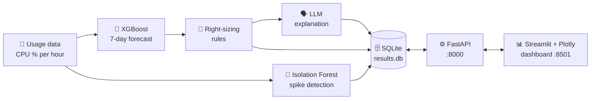

<div align="center">

# ⚡ OptiScale AI

### *Anveshan: The Clear Picture*
**Stop paying for servers nobody uses.**

<br>


<br>

**🔮 Forecast &nbsp;•&nbsp; 📏 Right-size &nbsp;•&nbsp; 💰 Save money &nbsp;•&nbsp; 🗣️ Explained in plain English**

<br>

[🚀 Quick Start](#-quick-start) · [🧠 How It Works](#-how-it-works) · [📁 Files](#-every-file-explained) · [✨ Features](#-features) · [📊 Use Your Data](#-use-your-own-data) · [🎬 Demo](#-3-minute-demo-script)

</div>

---

## 🎯 The Problem

> **AI00002 — Paying for Servers Nobody Uses**

Teams give their servers **more CPU than they need "just to be safe"**, then forget about them. Every unused vCPU is money burned, every single hour.

Meanwhile, the usage data that could fix this just sits there, never used.

## 💡 The Solution

OptiScale AI reads each server's past CPU usage and does four things:

| Step | What happens | Tool |
|:---:|---|---|
| 1️⃣ | **Predicts** the next 7 days of usage, hour by hour | XGBoost |
| 2️⃣ | **Spots** unusual spikes | Isolation Forest |
| 3️⃣ | **Recommends** how many vCPUs each server really needs, and how much money that saves | Right-sizing rules |
| 4️⃣ | **Explains** every recommendation in plain English | An LLM (or an offline fallback) |

It works in **both directions**. It tells you when a server is too big (**DOWNSIZE**), and also when one is about to run out of room (**UPSIZE**), so it helps prevent outages too.

---

## 🧠 How It Works



### The pieces talk like this

```
Dashboard (Streamlit :8501)  ──HTTP──▶  FastAPI (:8000)  ──▶  SQLite (results.db)

  sidebar upload ───────▶ POST /upload ──▶ ingest.py validates ──▶ run_pipeline.py ──▶ forecast + decisions
  charts ◀──────────────  GET /fleet, /recommendations, /forecast/{server} ...
```

> 🛟 **Safety net:** if the API isn't running, the dashboard reads the SQLite database directly, so a demo never dies.

---

## 🚀 Quick Start

### Option 1: ⚡ The easy way (recommended)

```bash
# 1. Create and activate a virtual environment
python -m venv venv
venv\Scripts\activate              # Windows
# source venv/bin/activate         # Mac / Linux

# 2. Install the libraries
pip install -r requirements.txt

# 3. Run everything with one command
python start.py
```

`start.py` runs the pipeline (first time only), the API and the dashboard together. Then open **http://localhost:8501** 🎉

### Option 2: 🔧 Step by step

```bash
python run_pipeline.py --regenerate     # makes fake data, trains models, fills the database
uvicorn api:app --reload                # Terminal 1 → http://127.0.0.1:8000/docs
streamlit run dashboard.py              # Terminal 2 → http://localhost:8501
```

### Option 3: 🐳 Docker

```bash
docker compose up --build
```
Dashboard at **http://localhost:8501**

### ✅ Check that everything works

| Command | What it checks |
|---|---|
| `python smoke_test.py` | The whole project, end to end |
| `python check_backend.py` | Every API endpoint (API must be running) |

In the dashboard sidebar:
🟢 **Green dot** = Backend connected &nbsp;|&nbsp; 🟠 **Amber dot** = reading saved results only

---

## ✨ Features

| | Feature | What it means |
|:---:|---|---|
| 🔮 | **7-day forecast per server** | XGBoost predicts CPU usage hour by hour, and each prediction feeds the next |
| 📏 | **Smart right-sizing** | Recommends the exact vCPU count, not a guess |
| 🛡️ | **Safety margin** | Decisions allow for forecast error, so you don't cut too deep |
| 🎯 | **Honest accuracy test** | Hides the last 7 days, forecasts them, then compares with reality |
| 🚨 | **Spike detection** | Isolation Forest flags abnormal usage |
| 💰 | **Money saved** | Shows ₹ waste found per month |
| 🗣️ | **Plain-English explanations** | Powered by Claude / Gemini / OpenAI / Ollama, with an offline fallback |
| 📤 | **Upload your own CSV** | Analyse real data right from the sidebar |
| 🌗 | **Two dashboards** | A dark AIOps dashboard (4 pages) and a simpler classic one |
| 🔌 | **REST API** | Interactive docs at `/docs` |
| 🐳 | **Docker support** | One command to run it all |
| 🧯 | **Never breaks in a demo** | Falls back to the database and to template explanations |

---

## 🤖 How the AI Works

> *A short tour in 5 steps, written for beginners and judges alike.*

### 1️⃣ Features: what the model looks at
For every hour, the model learns from:
- 🕐 hour of the day
- 📅 day of the week
- 🏖️ weekend or not
- ⏪ usage **24 hours ago**
- ⏮️ usage **7 days ago**
- 📈 the **24-hour** and **7-day averages**

### 2️⃣ Forecast
XGBoost predicts the next **7 days, hour by hour**. Each predicted hour is fed back in to predict the next one.

### 3️⃣ Honest accuracy
We hide the **last 7 days**, forecast them, then compare with what really happened (error measured as **MAE**). We also compare against a simple baseline, *"just repeat last week"*, to prove the AI is actually better.

### 4️⃣ Safety margin
```
safe peak = forecast peak + 2 × MAE
```
Forecasts are never perfect, so we add room for error.

### 5️⃣ Decision

| Situation | Decision |
|---|---|
| Busiest hour would be **above 85%** busy | 🔴 **UPSIZE** |
| Needs **at least 20% fewer** vCPUs | 🟢 **DOWNSIZE** |
| Anything else | ⚪ **KEEP** |

New size is chosen so the **busiest hour is about 70% busy**.

### 🧮 A worked example *(illustrative numbers)*

A server has **32 vCPUs**. The safe forecast peak needs about **7.7 vCPUs** of real work.

```
needed size = 7.7 ÷ 0.70 ≈ 11 vCPUs
```
That's well over 20% fewer than 32, so the decision is **DOWNSIZE: 32 → 11 vCPUs**.

At the assumed cost of ₹3.5 per vCPU-hour:
```
21 vCPUs saved × ₹3.5 × 24 hours × 30 days ≈ ₹52,920 / month
```

---

## 📁 Every File Explained

### 🗂️ Project map

```
PulseOPS/
├── 🧠 AI & data
│   ├── generate_data.py      → fake demo data
│   ├── ingest.py             → validates uploaded CSVs
│   ├── forecast.py           → XGBoost 7-day forecast
│   ├── anomaly.py            → Isolation Forest spikes
│   ├── recommend.py          → UPSIZE / DOWNSIZE / KEEP + savings
│   └── explain.py            → LLM explanations + offline fallback
│
├── ⚙️ Backend
│   ├── api.py                → FastAPI server
│   ├── db.py                 → SQLite setup
│   └── data_access.py        → helpers to read results
│
├── 📊 Frontend
│   ├── dashboard.py          → main dark dashboard (4 pages)
│   ├── dash_logic.py         → data logic behind the dashboard
│   ├── dashboard_classic.py  → simple light backup dashboard
│   └── .streamlit/           → dashboard theme settings
│
├── 🔗 Glue & tools
│   ├── run_pipeline.py       → runs the whole chain
│   ├── start.py              → one-command launcher
│   ├── config.py             → settings (e.g. cost per vCPU-hour)
│   ├── check_backend.py      → tests API endpoints
│   └── smoke_test.py         → tests the whole project
│
└── 📦 Setup
    ├── requirements.txt      → Python libraries
    ├── Dockerfile            → builds the app image
    ├── docker-compose.yml    → runs everything in Docker
    ├── .env.example          → template for your LLM key
    ├── .gitignore            → files Git should skip
    ├── .vscode/              → editor settings
    └── welcome.txt           → welcome message
```

### 🧠 AI & data

| File | What it does |
|---|---|
| **`generate_data.py`** | Creates realistic **fake hourly CPU data** for demo servers, so the project works with zero setup |
| **`ingest.py`** | The **gatekeeper**. Checks that an uploaded CSV has the right columns and enough data before anything runs |
| **`forecast.py`** | Trains **XGBoost** and predicts the next 7 days. Also measures its own accuracy |
| **`anomaly.py`** | Uses **Isolation Forest** to flag unusual usage spikes |
| **`recommend.py`** | The **decision maker**. Applies the sizing rules and calculates the savings |
| **`explain.py`** | Asks an **LLM** to explain each decision. Without an API key, it uses built-in template text |

### ⚙️ Backend

| File | What it does |
|---|---|
| **`api.py`** | The **FastAPI** server. The dashboard asks it for data over HTTP |
| **`db.py`** | Creates and manages the **SQLite** database (`results.db`) |
| **`data_access.py`** | Small helper functions that **read results** from the database |

### 📊 Frontend

| File | What it does |
|---|---|
| **`dashboard.py`** | The main **dark AIOps dashboard** (4 pages) built with Streamlit and Plotly |
| **`dash_logic.py`** | The **logic behind the dashboard**: preparing data and numbers for the charts |
| **`dashboard_classic.py`** | A simpler **light-style backup**. Run it with `streamlit run dashboard_classic.py` |
| **`.streamlit/config.toml`** | Dashboard **theme and appearance** |

### 🔗 Glue & tools

| File | What it does |
|---|---|
| **`run_pipeline.py`** | The **conductor**: data → forecast → decisions → explanations → database |
| **`start.py`** | **One command** to launch pipeline, API and dashboard together |
| **`config.py`** | Central **settings**, like the assumed ₹3.5 per vCPU-hour |
| **`check_backend.py`** | Tests **every API endpoint** while the API is running |
| **`smoke_test.py`** | A quick **health check** of the whole project |

### 📦 Setup files

| File | What it does |
|---|---|
| **`requirements.txt`** | List of Python libraries for `pip install` |
| **`Dockerfile`** / **`docker-compose.yml`** | Run the project inside Docker |
| **`.env.example`** | Template for your **private** LLM settings |
| **`.gitignore`** | Keeps secrets like `.env` out of Git |

---

## 🔌 API Endpoints

Start the API, then open **http://127.0.0.1:8000/docs** for an interactive page where you can try everything.

| Method | Endpoint | Returns |
|:---:|---|---|
| `GET` | `/fleet` | Overview of all servers |
| `GET` | `/recommendations` | UPSIZE / DOWNSIZE / KEEP for each server |
| `GET` | `/forecast/{server}` | The 7-day forecast for one server |
| `POST` | `/upload` | Upload a CSV, then validate, analyse and save it |

> The `/docs` page lists every endpoint, including ones not shown here.

---

## 📊 Use Your Own Data

### From the dashboard 🖱️
1. Open the **sidebar** → **Analyse your own data**
2. Upload your CSV
3. Click **Analyse my data**
4. The top bar now says *"Your uploaded data"* ✅

💡 Click **Download sample CSV** to see the exact format. Click **Re-run on demo data** to switch back.

### From the command line ⌨️
Put a file at `data/usage.csv` (or pass `--csv path`):

```bash
python run_pipeline.py --csv path/to/your.csv
```

### 📋 CSV format

Hourly rows with these columns:

| timestamp | server | cpu_percent | provisioned_cpus |
|---|---|---|---|
| 2026-01-01 00:00 | web-01 | 23.4 | 8 |
| 2026-01-01 01:00 | web-01 | 19.8 | 8 |

> ⚠️ You need **at least 16 days per server** (30+ days is better).

---

## 🗣️ Turn On the LLM Explanations *(optional)*

Without a key, you get template explanations. With one, you get real AI-written ones.

**1.** Copy `.env.example` to a new file named `.env` (same folder as `run_pipeline.py`).

**2.** Fill in two lines (no spaces or quotes needed):

```env
LLM_PROVIDER=anthropic
LLM_API_KEY=your-key-here
```

| `LLM_PROVIDER` | Service |
|---|---|
| `anthropic` | Claude |
| `gemini` | Google Gemini |
| `openai` | OpenAI |
| `ollama` | Local models, no key needed |

You can also set `LLM_MODEL=` to pick a specific model.

**3.** Restart the API and dashboard, then click **Re-run on demo data** (or run `python run_pipeline.py`). Cards change from *"(template explanation)"* to real LLM text. ✨

> 🔒 **Never commit or share your key.** `.env` is already in `.gitignore`.

---

## 🩺 Troubleshooting

| Problem | Try this |
|---|---|
| Dashboard shows an **amber dot** | The API isn't running. Start it with `uvicorn api:app --reload`, or just use `python start.py` |
| Explanations say **"(template explanation)"** | No LLM key is set. See the LLM section above |
| Command not found / import errors | Activate your virtual environment, then run `pip install -r requirements.txt` again |
| Empty dashboard | Run `python run_pipeline.py --regenerate` to rebuild the data and database |
| Not sure what's broken | Run `python smoke_test.py` and `python check_backend.py` |

---

## 🎬 3-Minute Demo Script

1. 🎤 **Problem:** *"Servers are sized for the worst case, and usage data is never used."*
2. 💰 **KPIs:** *"We found ₹X per month of waste."*
3. 📊 **Fleet chart:** `batch-01` pays for 32 vCPUs but needs about 11.
4. 🔍 **Server detail:** show the forecast, spikes and explanation. Show **app-02 (UPSIZE)** to prove the tool also **prevents outages**.
5. 🎯 **Accuracy tab:** the AI beats the "repeat last week" baseline.
6. 🔄 **Re-run analysis** with new data to show it's live.

---

## ⚠️ Honest Limitations

*We say these out loud. Judges respect honesty.*

- 🧪 Data is **simulated**, and the ₹3.5 per vCPU-hour cost is an **assumption**.
- 🖥️ **CPU only.** Memory, disk and network are the next step.
- 📈 Tree models **can't extrapolate** beyond what they've seen, so a sudden step-change in demand needs retraining.
- 📅 Forecasts use **recent history only**. Planned events (sales, launches) are unknown to the model.

## 🔭 What's Next

- [ ] Add memory, disk and network metrics
- [ ] Feed in planned events (sales, launches)
- [ ] Automatic retraining when demand shifts
- [ ] Connect to real monitoring sources

---

## 👥 Team & Ownership

| File(s) | Role | Owner |
|---|---|---|
| `generate_data.py`, `forecast.py`, `anomaly.py`, `recommend.py` | 🧠 Data, forecasting, spike detection, sizing rules | **Member 1** |
| `explain.py` | 🗣️ LLM explanations + offline fallback | **Member 2** |
| `dashboard.py`, `dash_logic.py`, `dashboard_classic.py`, `.streamlit/` | 🎨 Dashboard and presentation | **Member 3** |
| `api.py`, `db.py`, `data_access.py`, `Dockerfile`, `docker-compose.yml` | ⚙️ API, database, Docker, Git | **Member 4** |
| `run_pipeline.py`, `config.py` | 🔗 Glue and settings | **Everyone** |

---

<div align="center">

### ⚡ Built for the AI Ops Hackathon

*Because every idle vCPU is money you'll never get back.*

⭐ **Star this repo if it helped you!** ⭐

</div>
